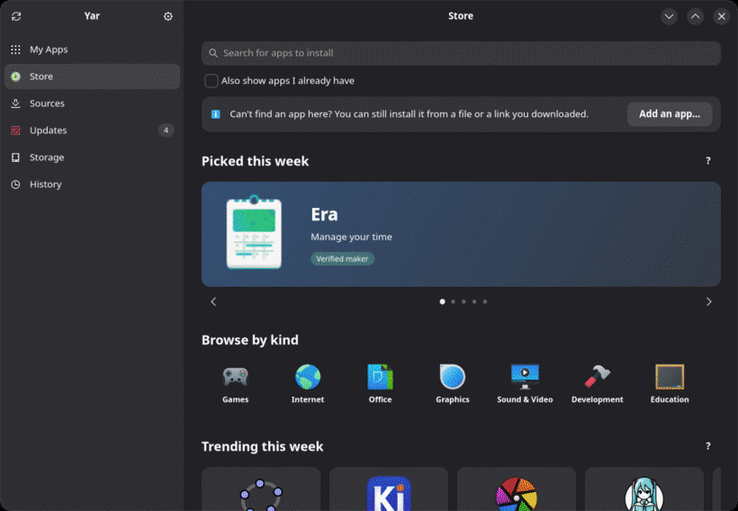
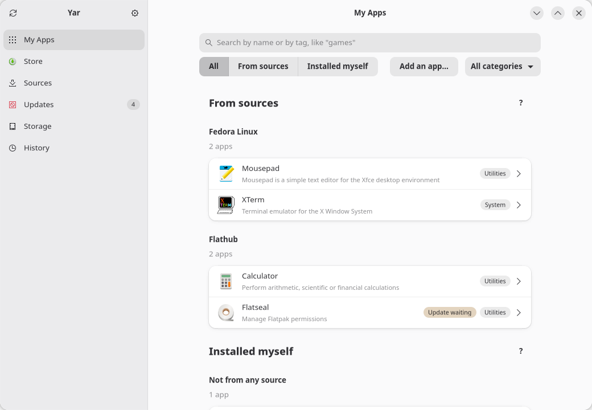
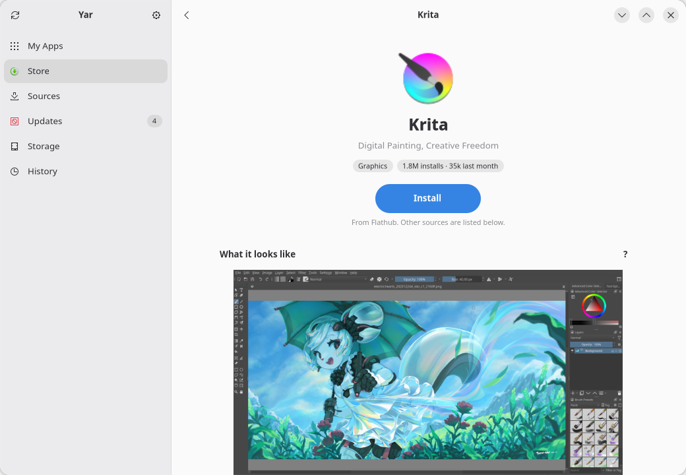
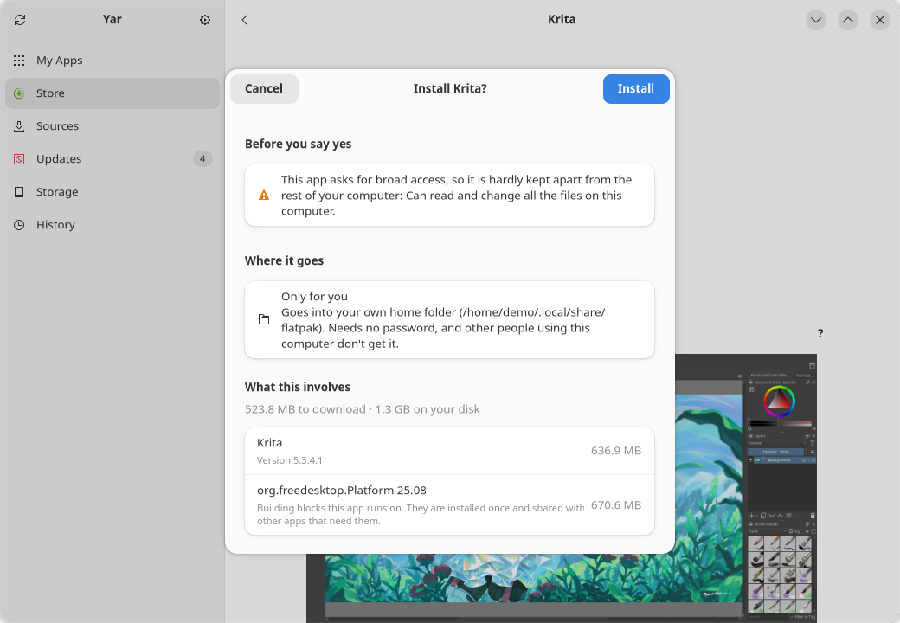
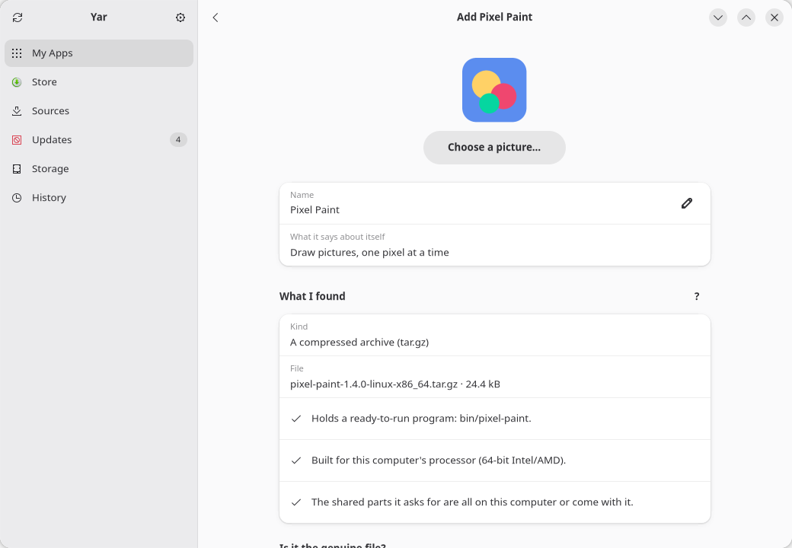
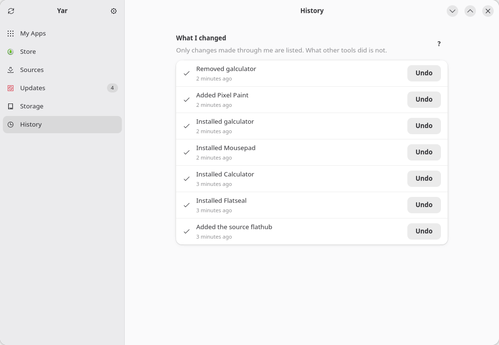
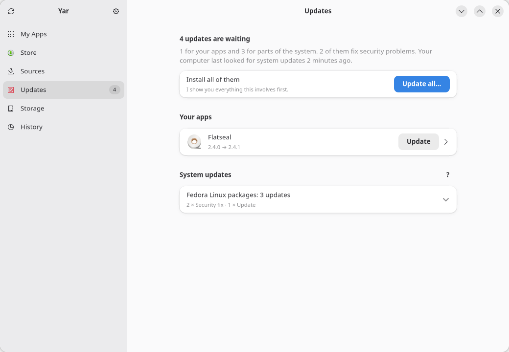

<div align="center">


# Yar

**An app manager for Linux: every installed app, from any source, in one place.**

[](https://github.com/mirinio/yar/actions/workflows/ci.yml)
[](https://github.com/mirinio/yar/releases)
[](LICENSE)


</div>

On Linux, apps come from several places: the distribution's packages, Flatpak, Snap, and files
downloaded from websites. Each is managed with a different tool. Yar shows them together and
lets you install, update and remove them from one window, with a preview before every change.

<p align="center">
  
</p>

<table>
<tr>
<td width="50%">

<picture>
  <source media="(prefers-color-scheme: dark)" srcset="docs/screenshots/my-apps-dark.png">
  
</picture>

**My Apps**: everything installed, grouped by source.
</td>
<td width="50%">

<picture>
  <source media="(prefers-color-scheme: dark)" srcset="docs/screenshots/store-app-dark.png">
  
</picture>

**Store**: one entry per app, with every source that offers it.
</td>
</tr>
<tr>
<td width="50%">

<picture>
  <source media="(prefers-color-scheme: dark)" srcset="docs/screenshots/install-preview-dark.png">
  
</picture>

**Preview**: what will be installed, its size and any warnings.
</td>
<td width="50%">

<picture>
  <source media="(prefers-color-scheme: dark)" srcset="docs/screenshots/add-app-dark.png">
  
</picture>

**Add an app**: from a downloaded file or a link.
</td>
</tr>
<tr>
<td width="50%">

<picture>
  <source media="(prefers-color-scheme: dark)" srcset="docs/screenshots/history-dark.png">
  
</picture>

**History**: every change made through Yar, with Undo.
</td>
<td width="50%">

<picture>
  <source media="(prefers-color-scheme: dark)" srcset="docs/screenshots/updates-dark.png">
  
</picture>

**Updates**: one app, all apps, or everything.
</td>
</tr>
</table>

## Using Yar

**See what is installed.** *My Apps* lists every app in your app menu, grouped by where it
came from. Search by name or by category. An app's page shows its version and size, where
its files and data are, and what it is allowed to access (for Flatpak apps).

**Install an app.** Search the *Store*, open the app and press **Install**. If several sources
offer it, each is listed with how it differs; the suggested one is marked. A preview shows
everything that will be installed, the download and disk size, and warnings such as access
to all your files. Nothing happens until you confirm. System packages ask for your password
in your system's own dialog.

**Add an app you downloaded.** Drop the file on the window, use **Add an app…** in *My Apps* or
the *Store*, or paste a download link. Supported: AppImage, single programs, zip and tar
archives, `.rpm` / `.deb` packages, `.flatpakref` / `.flatpak`. Yar identifies the file
without running it and checks that it can run on this computer. In the preview you can change
the name, picture, install folder and the program that starts it, add it to the app menu or
taskbar, and paste the publisher's checksum to verify the file. AppImages and archives go to
`~/Applications` by default (changeable in the settings) and get an app-menu entry; packages
go through your package manager, Flatpak files through Flatpak.

**Update.** The *Updates* tab lists waiting updates with security fixes marked. Update one
app, all apps, or everything; each shows a preview first.

**Remove.** Press **Remove** on an app's page. Its settings and data are kept unless you choose
to remove them too; removed data goes to the Trash. Apps added from a file are removed exactly,
using the record Yar kept when it added them.

**Undo.** *History* lists every change made through Yar. Most can be undone: an installed app
is removed again, a removed one is reinstalled and its data restored from the Trash. Updates
cannot be undone.

**Sources and storage.** *Sources* shows where your apps come from, lets you add Flatpak
sources and turn sources on or off. *Storage* shows your disks and how much space each app
and its data take.

## Install

**From a release**: download `yar-<version>-linux-x64.tar.gz` from
[Releases](https://github.com/mirinio/yar/releases) and check it against the `.sha256` file next
to it, then:

```bash
tar -xzf yar-*-linux-x64.tar.gz
cd yar-*-linux-x64
./install-local.sh        # installs for your user only, no password; ./uninstall-local.sh removes it
```

**From source**, with the .NET 10 SDK:

```bash
git clone https://github.com/mirinio/yar.git && cd yar
dotnet run --project src/Presentation/Yar.Gtk
```

Requirements: GTK 4.14 or newer and libadwaita 1.5 or newer.

## Where it works

| | Status |
|---|---|
| Fedora 44 (KDE Plasma) | Developed and used here |
| Ubuntu 24.04 | Installing, removing, updating and adding apps tested in a container; the window itself not yet tried |
| openSUSE, Arch, others | Not tried; Yar uses PackageKit, so they may work |
| Snap | Snap apps are listed; installing and removing snaps is not supported yet |
| Not yet tried on a real desktop | The system password prompt, dropping a file with the mouse, pinning to the taskbar |

Reports from other distributions are welcome in the [issues](https://github.com/mirinio/yar/issues).

## How it works

- **Apps come from launchers.** Yar reads every app-menu entry (`.desktop` file) and asks each
  backend which ones it owns: Flatpak, then Snap, then the distribution's packages; what is left
  was installed by hand. This keeps libraries and command-line tools out of the list.
- **Backends**: distribution packages through PackageKit over D-Bus (dnf, apt, zypper, pacman),
  Flatpak through the `flatpak` command, Snap through snapd's socket. The Store reads the app
  catalogs (AppStream) already on your computer.
- **Every change is planned first.** The backend works out what a change involves (for packages,
  a simulated transaction), Yar shows that plan, and carries out exactly that plan once you
  confirm. Changes run one at a time and can be cancelled.
- **Every change is recorded** in `~/.local/state/yar/history.jsonl`, which is what *History*
  and Undo use.
- **Downloaded files are never run** to inspect them. Archives are unpacked into a temporary
  folder first, with checks against paths that leave the folder, links pointing outside, and
  oversized content. For each added app Yar keeps a note of what it created, in
  `~/.local/share/yar/apps`.
- **Removing goes to the Trash**, and a removal that would take a vital system package with it
  (kernel, systemd, the package manager, the desktop) is refused.
- **Yar never runs as root.** Changes outside your home folder go through PackageKit or Flatpak,
  which ask for your password themselves.
- `yar-apps` is a command-line tool that does what the window does, for scripting and testing:
  `yar-apps apps`, `yar-apps install <id>`, `yar-apps add <file>`, `yar-apps history` and more;
  changes need `--yes`.

More about safety in [SECURITY.md](SECURITY.md).

### What goes over the internet

All optional, behind one switch in the settings:

| What | From | What Yar sends |
|---|---|---|
| Star ratings and reviews | odrs.gnome.org | For reviews: the app, your language, your distribution's name, a random ID |
| Picks, trending, install counts, sizes, permissions | flathub.org | The app's ID |
| Pictures of apps | dl.flathub.org, dl.fedoraproject.org, appstream.ubuntu.com, appstream.debian.org | The picture's address |
| New GitHub projects (off by default) | api.github.com | The programming languages you chose |

A download link you paste is fetched from wherever it points, over https only.

## Contributing

[CONTRIBUTING.md](CONTRIBUTING.md) explains how the code is organised, how to build and test,
and the throwaway container in which installs are tested for real. Yar is written in C# on
.NET 10 with GTK 4 and libadwaita through [Gir.Core](https://gircore.github.io).

Yar is developed with the help of an AI assistant (Claude, by Anthropic). [AI.md](AI.md)
describes how the work is checked.

## License

GPL-3.0-or-later. See [LICENSE](LICENSE).
